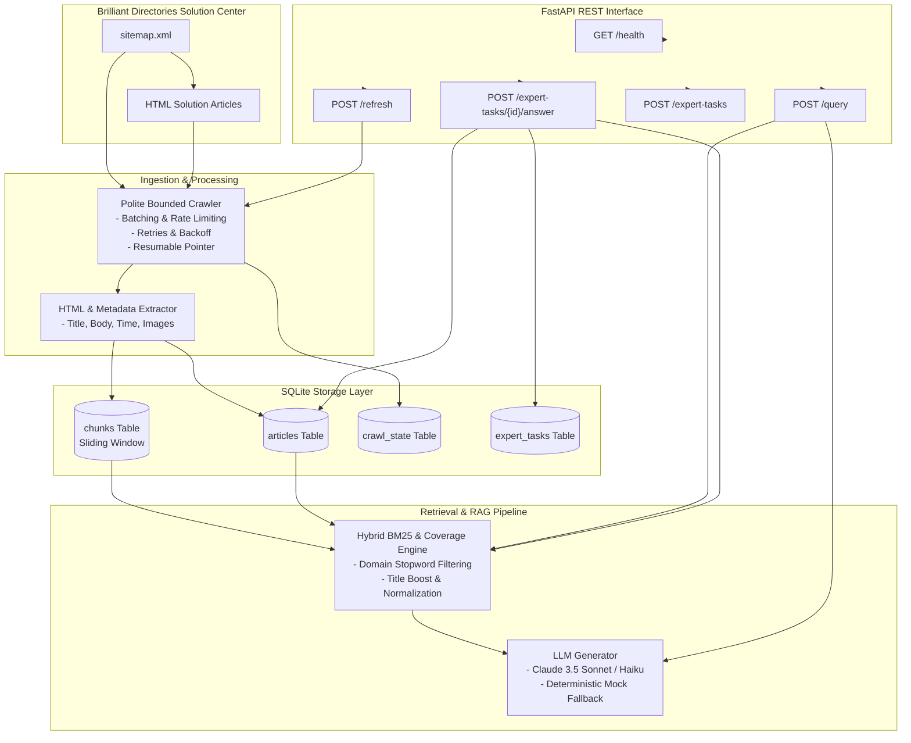

# DESIGN.md — Task 1: Knowledge Brain Architecture & Specification

## 1. System Overview

The **Knowledge Brain** is an enterprise-grade AI technical documentation ingestion, retrieval, and synthesis engine built for **Brilliant Directories**. It automates documentation crawling from the official Solution Center, performs hybrid retrieval with source citations, enforces honest insufficient-evidence detection, supports incremental refresh, and incorporates human-in-the-loop expert review.



---

## 2. Database Schema (SQLite WAL Mode)

The system persists all data in a local SQLite database with Write-Ahead Logging (WAL) enabled:

1. **`articles` Table**:
   - `id`: INTEGER PRIMARY KEY AUTOINCREMENT
   - `url`: TEXT UNIQUE NOT NULL
   - `title`: TEXT NOT NULL
   - `body_text`: TEXT NOT NULL
   - `published_at`: TEXT
   - `images_json`: TEXT (JSON array of image URLs)
   - `content_hash`: TEXT (SHA-256 for change detection)
   - `crawled_at`: TEXT (ISO-8601 UTC)
   - `is_expert_answer`: INTEGER (1 for human-approved expert answers, 0 for scraped docs)

2. **`chunks` Table**:
   - `id`: INTEGER PRIMARY KEY AUTOINCREMENT
   - `article_id`: INTEGER (Foreign key to `articles(id)`)
   - `chunk_index`: INTEGER
   - `text`: TEXT (250-word sliding window with 40-word overlap)

3. **`crawl_state` Table**:
   - `key`: TEXT PRIMARY KEY (`last_crawl_index`, `last_refresh_at`)
   - `value`: TEXT
   - `updated_at`: TEXT

4. **`expert_tasks` Table**:
   - `task_id`: TEXT PRIMARY KEY
   - `question`: TEXT NOT NULL
   - `context`: TEXT
   - `status`: TEXT (`pending_review`, `incorporated`)
   - `suggested_answer`: TEXT
   - `approved_answer`: TEXT
   - `expert_name`: TEXT
   - `created_at`: TEXT
   - `updated_at`: TEXT

---

## 3. Documented HTTP API Specification

Base URL: `http://127.0.0.1:8001`

### 3.1 `GET /health`
Returns system health, total indexed article count, vector store status, and last refresh timestamp.

**Response `200 OK`**:
```json
{
  "status": "healthy",
  "version": "1.0.0",
  "articles_count": 19,
  "last_refresh_at": "2026-10-18T15:30:21Z",
  "vector_store_ready": true
}
```

---

### 3.2 `POST /query`
Performs hybrid retrieval against indexed articles and answers the query with verified source citations. If the knowledge base lacks authoritative support or the query is out of domain, an honest insufficient-evidence response is returned.

**Request**:
```json
{
  "query": "Can I send a mass email campaign using Brilliant Directories?",
  "top_k": 3,
  "confidence_threshold": 0.35
}
```

**Success Response `200 OK`**:
```json
{
  "query": "Can I send a mass email campaign using Brilliant Directories?",
  "answer": "According to Brilliant Directories documentation (Can I Send A Mass Email Campaign Using Brilliant Directories?): Brilliant Directories includes an integrated newsletter and mass email marketing feature located under My Members > Send Newsletter. You can send email blasts to all registered members or specific membership tiers.",
  "sources": [
    {
      "title": "Can I Send A Mass Email Campaign Using Brilliant Directories?",
      "url": "https://support.brilliantdirectories.com/support/solutions/articles/5000558357-can-i-send-a-mass-email",
      "relevance_score": 0.88,
      "snippet": "Brilliant Directories has an integrated newsletter and mass email marketing feature located under My Members > Send Newsletter...",
      "published_at": "2024-01-01T00:00:00Z",
      "images": [
        "https://support.brilliantdirectories.com/images/email-campaign.png"
      ]
    }
  ],
  "insufficient_evidence": false,
  "confidence": 0.88,
  "model_used": "claude-3-5-sonnet-20241022",
  "latency_ms": 12
}
```

**Honest Insufficient Evidence Response `200 OK`**:
```json
{
  "query": "What is the warp drive speed limit of Brilliant Directories?",
  "answer": "INSUFFICIENT_EVIDENCE: The Brilliant Directories Solution Center documentation does not contain sufficient information to answer 'What is the warp drive speed limit of Brilliant Directories?'.",
  "sources": [],
  "insufficient_evidence": true,
  "confidence": 0.05,
  "model_used": "claude-3-5-sonnet-20241022",
  "latency_ms": 0
}
```

---

### 3.3 `POST /refresh`
Executes bounded, polite, resumable incremental refresh from the sitemap. Detects new pages, updated pages, and removed pages.

**Request**:
```json
{
  "max_pages": 25,
  "force_full": false
}
```

**Response `200 OK`**:
```json
{
  "pages_scanned": 15,
  "pages_added": 15,
  "pages_updated": 0,
  "pages_removed": 0,
  "elapsed_seconds": 14.15,
  "total_articles_in_db": 19
}
```

---

### 3.4 `POST /expert-tasks`
Creates a human-review task when an incoming customer query cannot be answered automatically or requires manual expert resolution.

**Request**:
```json
{
  "question": "How do I connect Brilliant Directories to custom COBOL mainframe?",
  "context": "Enterprise client ticket #4092",
  "suggested_answer": null
}
```

**Response `201 Created`**:
```json
{
  "task_id": "task_811479cc",
  "question": "How do I connect Brilliant Directories to custom COBOL mainframe?",
  "context": "Enterprise client ticket #4092",
  "status": "pending_review",
  "created_at": "2026-10-18T15:20:00Z",
  "approved_answer": null,
  "expert_name": null,
  "updated_at": null
}
```

---

### 3.5 `POST /expert-tasks/{task_id}/answer`
Submits an approved expert answer, immediately indexing it into SQLite chunks and the hybrid retriever for all future queries.

**Request**:
```json
{
  "approved_answer": "To integrate Brilliant Directories with COBOL mainframes, use the Webhook Notification Manager to dispatch member event payloads to an intermediate API bridge.",
  "expert_name": "Chief Architect",
  "source_reference": "Verified Enterprise Architecture"
}
```

**Response `200 OK`**:
```json
{
  "task_id": "task_811479cc",
  "status": "incorporated",
  "indexed_article_id": "article_18",
  "updated_at": "2026-10-18T15:21:00Z"
}
```

---

## 4. Politeness, Rate Limiting & Resilience
- **Polite Crawl Delay**: 200 ms sleep between page fetches.
- **Custom User-Agent**: Identifies the MVP research bot transparently.
- **Exponential Backoff**: Up to 3 retries with exponential backoff on HTTP timeouts and server errors.
- **Resumable Pointer**: Slices batches using `last_crawl_index` stored in SQLite so successive runs pick up where the previous left off.
- **Deterministic Mock Provider**: Fallback executes automatically when `ANTHROPIC_API_KEY` is omitted or rates limit, enabling zero-cost test runs.
